# 视觉采集、OCR、摄像头与连续视频计数（补充材料）

> 负责范围：`photo_capture` 的采集 GUI、摄像头选择/画质预设、中文文字 OCR、车牌 OCR、
> MLX90640 热像模式，以及电动车连续视频唯一计数。
> 对应《定稿补充材料清单》：2.3.3 视觉/感知、3.2.2、图 3-1；附录代码与测试记录。
> 代码仓库：`~/bit_ws`。文中“已验证”只代表离线图片/本机设备测试，未写实车整轮结果。

## 1. 状态总表

| 功能 | 实现位置 | 当前状态 | 说明 |
|---|---|---|---|
| 摄像头选择 | `capture_photos.py` `CameraSelectDialog` | 已验证 | 列 `/dev/video*`，按 sysfs 名去重；支持手动输入 |
| 新相机画质预设 | `capture_photos.py` `apply_gui_camera_defaults` | 已验证本机取流 | Fic760x 5MP/15fps/sharp32，检测/扫描 720p/30 |
| 中文 OCR | `ocr_engine.py` `ChineseOcr` | 离线样例通过 | PaddleOCR，可选 YOLO 先裁剪 |
| 车牌 OCR | `ocr_engine.py` `PlateOcr` | 离线单张沙盘车模通过 | `plate.pt` 裁剪 + 通用 OCR / HyperLPR3 |
| 电表 OCR | `ocr_engine.py` `MeterOcr` | 离线单张站房照片通过 | `voltage.pt` 裁 `shuju` 数字屏 + PaddleOCR |
| 连续视频计数 | `count_video.py` | 离线 4 段视频通过 | Cycle.pt + ByteTrack，唯一 ID 计数 |
| MLX90640 热像 | `capture_photos.py` `ThermalApp` | 回放通过；实机串口未验证 | `capture.bin` 回放、四层标定、双画面/快照 |
| 实车/整轮视觉指标 | — | **未测** | 需现场相机、模型和导航联调 |

## 2. 图 3-1 用的采集/识别链路

```text
Fic760x / Orbbec RGB (UVC)
        │
        ▼
CameraSelectDialog ──► Camera（按设备/模式选 2592×1944 或 1280×720）
        │
        ├── photo：单拍/连拍
        ├── detect：YOLO 实时检测
        ├── scan：横移关键帧 + sweep.avi
        │        └── count_video：YOLO → ByteTrack → 唯一 track ID 计数
        ├── OCR：plate.pt / 楼宇 YOLO 裁剪 → PaddleOCR / HyperLPR3
        └── thermal：MLX90640 串口/回放 + RGB 双画面
```

OCR 不逐帧跑：按一次抓当前帧，在后台线程加载模型和推理，主线程只负责预览/结果显示。

## 3. 摄像头选择与新相机画质配置

### 3.1 设备识别

2026-11-19 本机枚举：

| video 节点 | sysfs name | 用途 |
|---|---|---|
| `/dev/video0` | `Fic760xUsbCamera: Usb HDCamera` | 新白光相机（5MP/4K） |
| `/dev/video1` | 同上 | 同设备 metadata 节点，不取流 |
| `/dev/video2` | `Orbbec DaBai DCW2 RGB Camera` | 深度相机 RGB |

GUI 选完模式后弹「选择摄像头」，按物理设备名去重，只显示 video0、video2；也可以手动输入
`/dev/video2`、`2` 或视频文件。选中结果用于本次所有模式；显式 `--device` 时跳过弹窗。

### 3.2 Fic760x 预设

按 [camera_quality_tuning.md](../camera_quality_tuning.md) 的实测结论写入 GUI：

| 模式 | 分辨率 | FPS | 格式 | 锐度 |
|---|---|---|---|---|
| 拍照 / 仪表 / OCR | **2592×1944**（5MP，4:3） | 15 | MJPG | 32 |
| 检测 / 区域扫描 | 1280×720 | 30 | MJPG | 32 |
| 热像的 RGB 预览 | 1280×720 | 30 | MJPG | 32 |
| Orbbec / 旧相机 | 1280×720 | 相机默认 | 自动 | 3 |

- 5MP 是中心裁切，取景比 16:9 窄约 1.33×；4K 保留 16:9 全视野，只建议拍照备选；
- 用户显式 `--width/--height/--fps/--sharpness` 优先；4K 用
  `--width 3840 --height 2160`；
- 对焦是手动镜头，`Focus, Absolute/AF` 实测无效（Laplacian 方差变化 <1%），
  GUI 不暴露 focus；清晰度先靠拧镜头环；
- `Camera.open()` 顺序为 FOURCC → 分辨率 → FPS → 其他控制，MJPG 由分辨率触发。

本机验收：`/dev/video0` 实际打开 `2592×1944`，fourcc=MJPG，读帧成功，sharpness=32。

## 4. 中文文字 OCR

- 引擎：PaddleOCR 2.6.1.0 / paddle 2.6.2，`lang=ch`，`use_angle_cls=True`；
  模型缓存 `~/.paddleocr/whl`，CPU 推理；
- 默认整图 OCR；中文页签可选任意 Ultralytics `.pt` 先检测，再按框外扩 6% 裁剪，
  最多取面积最大的 8 个框，对每个裁剪图 OCR 后把文字框坐标映射回原图；
- 模型没框、或裁剪图无文字时自动回退整图；
- 画框使用青蓝色，不使用绿色。

样例（合成图，仅验证链路，非现场精度）：

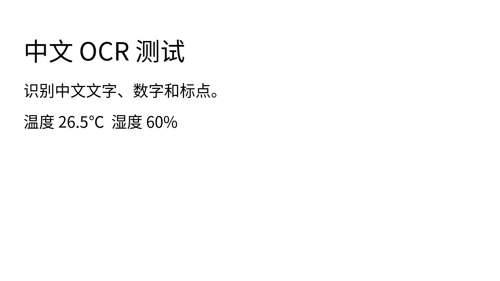

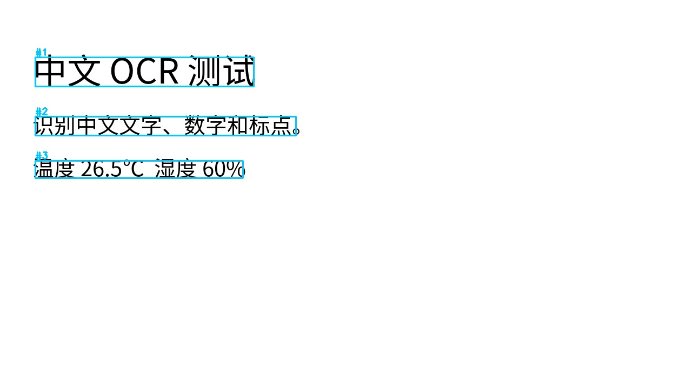

结果：3 行文字，置信度 0.98 / 0.93 / 0.78；首次模型加载约 0.7 s（本机 CPU）。
这不是现场准确率，不能据此写 OCR 精度。

## 5. 车牌 OCR（含沙盘非标车牌）

### 5.1 两种模式

车牌页签先选 **车牌 YOLO 裁剪模型**（默认自动加载 `~/AI视觉/plate.pt`，不存在时整图检测），
再选识别后端：

1. **通用 OCR（沙盘/非标，默认）**：PaddleOCR 读裁剪图，不要求首字是省份；
2. **HyperLPR3（真实车牌）**：给裁剪图外扩 35% 灰色背景再识别，保留车牌类型/置信度；
3. 模型没框或裁剪无文字时回退整图检测。

选择通用 OCR 的原因：HyperLPR3 的识别字典按真实中国车牌设计，沙盘车牌首字可能不是省份，
会被“纠正”为省份。典型误判样例：

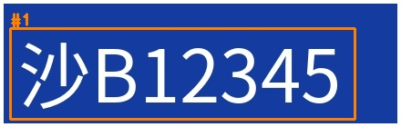

```text
真值：沙B12345
通用 OCR：沙B12345  0.94
HyperLPR3：京B12345 蓝牌 0.90（首字误判）
```

### 5.2 实际沙盘车模单张

原始图：

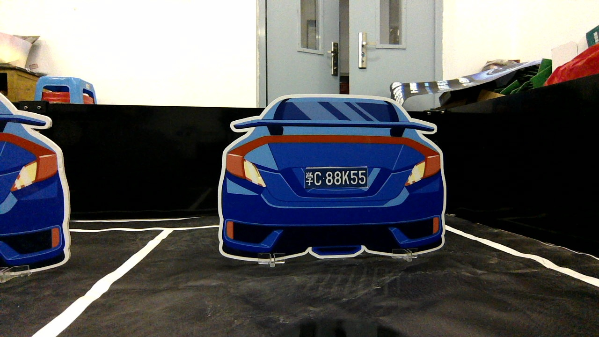

`plate.pt` 检测到 1 个车牌框后，通用 OCR 结果：

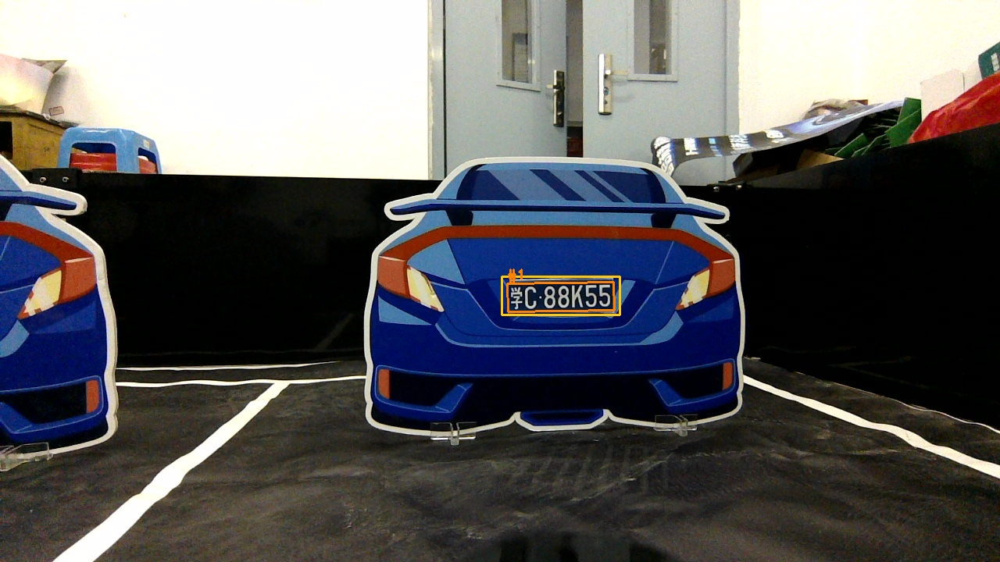

```text
真值：学C·88K55
通用 OCR：学C·88K55  0.84
HyperLPR3：学C88K55 蓝牌 0.94（少了分隔点，类型为真实车牌分类）
```

单张、离线、沙盘车模；不能代表现场准确率。首轮含模型加载约 4.2 s，模型热态约 0.5–0.8 s，
未做系统 benchmark。

## 5.1 电表 OCR（OCR 第三个页签）

- 模型：`~/AI视觉/voltage.pt`，类别 `wendu/shidu/shuju`；只取 `shuju` 数字屏；
- 流程：YOLO 裁 `shuju` → 外扩 6% → PaddleOCR 读数字 → 正则取数值 → 输出 `123.4 kWh`；
- 实测图 `最终机位拍摄仪表_20261120_200558_459_0082.jpg`：
  - `voltage.pt` 检出 shuju，置信度 0.96；
  - PaddleOCR 读出 `123.4` 和 `kWh`，最终 `123.4 kWh`；
- 这是离线单张验证，不是现场精度；未做多亮度/多读数集和误差统计。

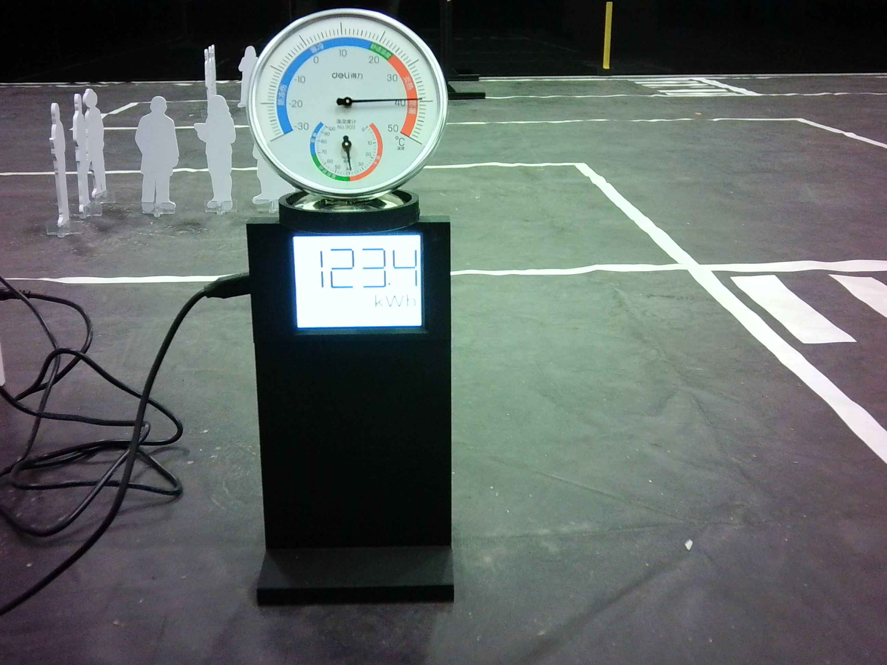

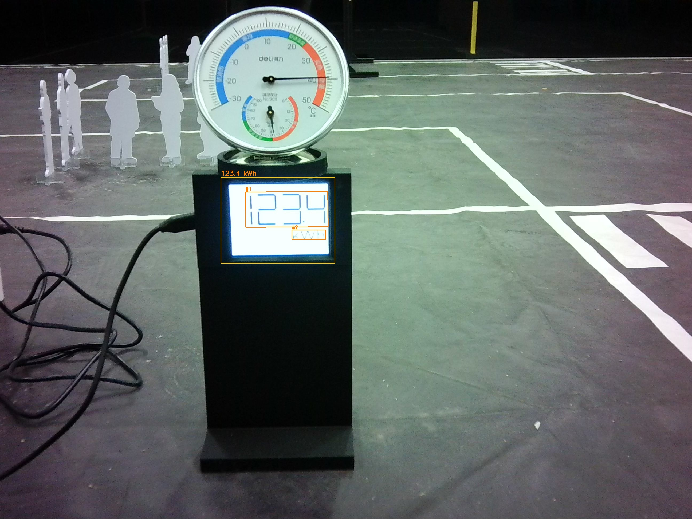

## 6. 电动车连续视频唯一计数

详细技术栈见 [electric_scooter_video_counting.md](../electric_scooter_video_counting.md)。

```text
区域扫描连续录 sweep.avi（1280×720@15）
  → Cycle.pt 逐帧检测 UP/DOWN
  → ByteTrack 分配 track ID
  → 过滤 < min_frames（默认 20）的短轨迹
  → 每条轨迹类别多数投票
  → 唯一 track ID 数量
  → count.txt / track_summary.json / sweep_tracked.avi / 裁剪图
```

- 模型：`~/AI视觉/Cycle.pt`，2 类 UP/DOWN；CPU；`imgsz=640`，`conf=0.25`；
- 关键参数：`min_frames=20`，15fps 下约 1.3 s；
- 逐帧检测不能直接相加：同一辆车会跨多帧出现，必须用唯一 ID；
- 单帧最多只看到 4 辆，整段视频跟踪补出第 5 辆，说明单帧计数不可靠。

离线测试（4 段扫掠视频，人工真值均为 5 辆）：

| 视频 | 帧数 | 总数 | UP / DOWN | 结果 |
|---|---:|---:|---|---|
| 采集_01 | 198 | 5 | 4 / 1 | 正确 |
| 采集_02 | 199 | 5 | 3 / 2 | 正确 |
| 采集_03 | 139 | 5 | 0 / 5 | 正确 |
| 采集_04 | 144 | 5 | 5 / 0 | 正确 |

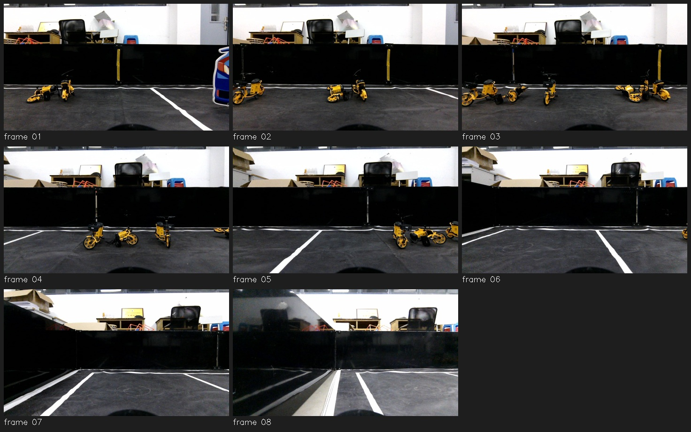

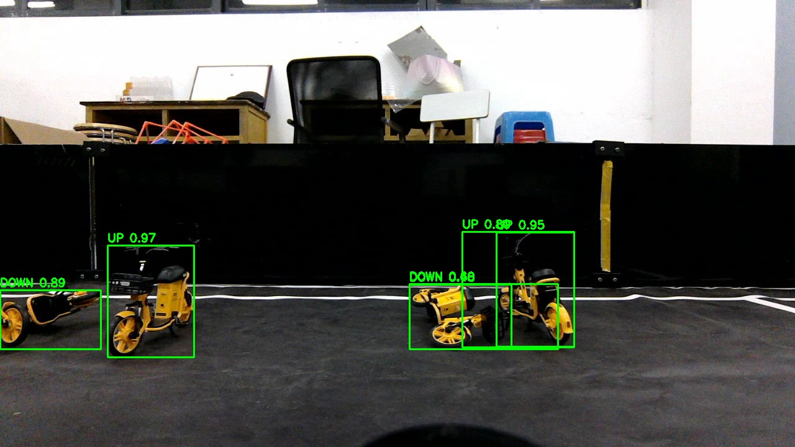

用时：约 28 s / 270 帧（CPU，早前记录，未重复计时）。四段视频是离线后处理，
最终导航/视觉服务整轮联调未完成；不能写成实车在线指标。

## 6.1 拼接全景方案的坑（已放弃作为计数输入）

最初用“横移 8 帧 → 拼接全景 → 全景上 YOLO 数框”。全景适合看覆盖范围，但不适合唯一计数：

- **3D 视差**：墙、桌面、电动车不在同一平面，单应矩阵只能对齐一个平面，接缝处同一辆车会错位/重影；
- **接缝重复**：重叠区同一辆车可能被拼两次，检测框也出现两次；没有 track ID，无法判断是不是同一辆；
- **低纹理失败**：黑色背景墙/地胶特征弱，实测关键帧 07/08 基本只剩地面，全景有黑边/拉伸；
- **小目标变糊**：全景缩到检测尺寸后单辆车只有几十像素，倒地/遮挡车容易漏；
- **静态图补不回漏检**：单帧最佳只有 4 辆，真实 5 辆；全景没有前后帧信息，缺的车无法补；
- **框数直接求和会系统性多算**：拼接重影 + 分块边界重复，不能作为上报数量。

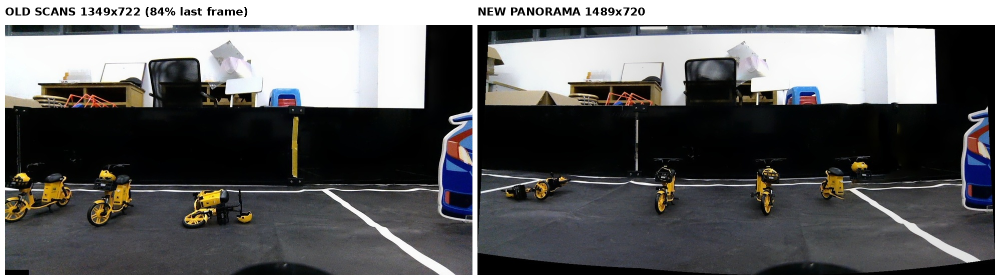

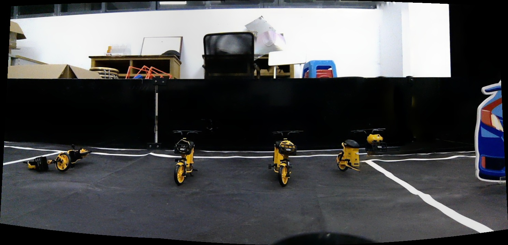

因此最终改用连续视频：`sweep.avi` → Cycle.pt 逐帧 → ByteTrack 唯一 ID → 短轨迹过滤 →
类别投票。4 段视频计数均为 5，单帧最佳图只有 4 辆，正是放弃单帧/全景计数、改用视频跟踪的
直接证据。

## 7. MLX90640 热像模式

- `photo_capture` 第 5 模式；通过 `mlx90640_ros.thermal_session` 公开接口，
  **未修改** `mlx90640_ros` 内部；
- 数据源：`capture.bin` 回放或 `/dev/thermal` 串口；
- 显示：热像 + RGB 双画面；`S` 保存 PNG+JSON，可额外保存 IR+RGB 拼图；
- 四层标定：每层记录 2–3 次峰值行取中位数，按相邻楼层中心划分 row 区间；
  默认表 `4F:0-5,3F:6-11,2F:12-17,1F:18-23` 只是等分占位，必须现场重录；
- 无世界坐标，判层只用 24×32 温度矩阵的图像行号。

回放样例：

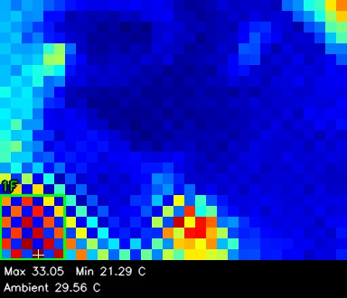

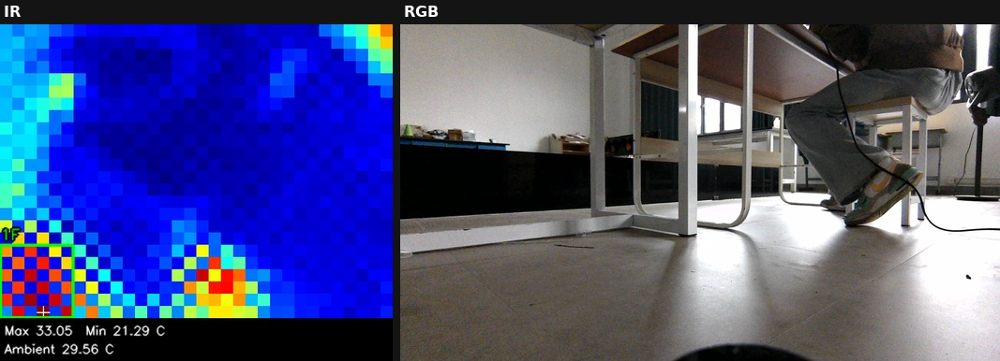

状态：回放出图、双画面和快照已验证；实机串口未收到热像帧（短测 6 s 无帧无报错），
实车四层标定未做。因此当前只能写“离线/单点验证”，不能写正式温度判定指标。

## 8. 清单感知单项回填（2.3.3 / 3.2.2）

| 任务 | 版本 | 条件 | 真值口径 | 样本数 | 正确 | 漏检/误判 | 用时 | 样例/记录 |
|---|---|---|---|---|---:|---:|---|---|
| 中文 OCR | PaddleOCR 2.6.1 | 离线合成图 | 人工写入 3 行 | 1 图 / 3 行 | 3 行 | 0 / 0 | ~0.7 s（首次加载） | `assets/ocr_chinese_*` |
| 车牌通用 OCR | plate.pt + PaddleOCR | 离线单张沙盘车模 | 人工读 `学C·88K55` | 1 | 1 | 0 / 0 | ~4.2 s（首轮含加载） | `assets/ocr_plate_sandbox_*` |
| 车牌 HyperLPR3 | HyperLPR3 0.1.3 | 离线单张沙盘车模 | 人工读 `学C·88K55` | 1 | 1（少分隔点） | 0 / 0（类型不可作沙盘真值） | ~0.5 s 热态 | 同上 |
| 沙盘非标车牌误判 | HyperLPR3 0.1.3 | 离线合成 | 人工读 `沙B12345` | 1 | 0 | 0 / 1（首字误判） | — | `ocr_plate_sandbox_fake_province*` |
| 电表 OCR | voltage.pt + PaddleOCR | 离线单张站房照片 | 人工读 `123.4 kWh` | 1 张 | 1 | 0 / 0 | 首轮约4.5 s（含加载），热态约1.0 s | `assets/meter_*` |
| 电动车视频计数 | Cycle.pt + ByteTrack | 离线 4 段视频 | 人工真值 5 辆/段 | 4 段 | 4 段 | 0 / 0 | 约 28 s/270 帧 | 第 6 节表格 |
| 电动车单帧 | Cycle.pt | 离线单帧 | 人工 5 辆 | 1 帧 | 4 辆 | 1 漏（单帧） | — | `ebike_best_frame.jpg` |
| 新相机取流 | Fic760x | 本机实机 | — | 1 设备 | 5MP 读帧成功 | — | — | 第 3 节 |
| 热像回放 | capture.bin | 离线回放 | 无楼层真值 | 1 段 | 显示/快照通过 | 未测 | — | `thermal_replay.jpg` |

> 说明：以上“正确”是按当前小样本人工核对，不是完整测试集精度；OCR 模型训练数据/划分、
> 车牌模型训练数据/划分本文未获得，需模型负责人补。现场实车、整轮、在线指标均未测。

## 9. 复现

```bash
source ~/bit_ws/devel/setup.bash

# GUI 选择摄像头，自动套用 Fic 预设
rosrun photo_capture capture_photos.py --mode ocr

# 5MP 拍照
rosrun photo_capture capture_photos.py --mode photo \
  --device /dev/video0 --width 2592 --height 1944 --sharpness 32

# 4K 备选
rosrun photo_capture capture_photos.py --mode photo \
  --device /dev/video0 --width 3840 --height 2160

# 连续视频计数
python3 src/photo_capture/scripts/count_video.py \
  --video ~/Pictures/photo_capture/区域扫描/.../sweep.avi \
  --model ~/AI视觉/Cycle.pt --min-frames 20
```

## 10. 代码、提交与已知边界

- 摄像头选择/预设：`6bc0f94`；
- OCR：`6379c2c`、`da4f6da`；
- 连续视频接口：`9ca253c`；
- 热像模式：`24f1936`、`b5b2ee4`、`560ed23`；
- 新相机画质调研：`6496508`，文档 [camera_quality_tuning.md](../camera_quality_tuning.md)。

已知边界：

- OCR 只在离线图片/模拟摄像头上验证，真实相机 + 现场光照未测；
- 车牌模型 `plate.pt` 的训练/测试划分未提供；沙盘场景建议通用 OCR；
- 电动车视频计数是离线后处理，未接入最终整轮在线流程；
- 热像串口和四层标定未实车验证；
- 5MP/4K 长时间 GUI 预览的 CPU 占用未系统测试；USB2 与 Orbbec 同时高负载可能掉帧；
- 本 OCR 模式是 `photo_capture` GUI 的独立工具，尚未接入 `/inspection_vision` 服务或裁判上报，
  与 `01_导航_视觉_裁判_GUI.md` 中的统一视觉服务不是同一条链路；
- 本材料不包含导航、裁判、仪表 Exp16 的指标，避免与对应负责组重复或冲突。
